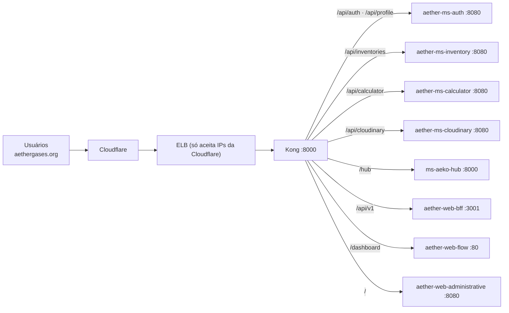

# Aether Kong Gateway

**Único ingress público** do [Aether](https://github.com/AetherGases). É um [Kong](https://konghq.com/) 3.9 em modo declarativo (DB-less): sem banco, sem Admin API, só um arquivo `kong.yml` empacotado em uma imagem Docker. Roda no cluster EKS (namespace `aether`) e encaminha cada caminho para o serviço interno correspondente.



## Rotas

Definidas em [`kong.yml`](kong.yml). Os destinos são DNS internos do cluster, no formato `http://<serviço>.aether.svc.cluster.local:<porta>`.

| Caminho público | Serviço | `strip_path` |
| --- | --- | --- |
| `/api/auth`, `/api/profile` | `aether-ms-auth` | não |
| `/api/inventories` | `aether-ms-inventory` | não |
| `/api/calculator` | `aether-ms-calculator` | não |
| `/api/cloudinary` | `aether-ms-cloudinary` | não |
| `/hub` | `ms-aeko-hub` | **sim** (`/hub/ai/...` chega como `/ai/...`) |
| `/hub/ai/mcp` | `ms-aeko-hub` | reescreve a URI para `/ai/mcp/` |
| `/api/v1` | `aether-web-bff` (BFF do portal web) | não |
| `/dashboard` | `aether-web-flow` | sim |
| `/` | `aether-web-administrative` | sim |

Kong escolhe a rota mais específica, por isso `/` (administração) não captura os demais caminhos.

## Quirks importantes

- **Timeouts do hub praticamente infinitos.** O serviço `ms-aeko-hub` usa `connect/read/write_timeout` de 2147483646 ms. As respostas da IA (agentes, relatórios) podem levar minutos e o Kong não deve cortá-las.
- **Rota MCP com regex.** O servidor MCP do hub fica em `/ai/mcp/` (com barra final). A rota `~/hub/ai/mcp$` casa o caminho público `/hub/ai/mcp` sem barra e, com o plugin `request-transformer`, reescreve a URI para `/ai/mcp/`. Essa rota usa `strip_path: false` porque a URI é substituída por inteiro.
- **IPs confiáveis.** `KONG_TRUSTED_IPS=0.0.0.0/0,::/0` faz o Kong respeitar o `X-Forwarded-Proto: https` da Cloudflare, necessário para o BFF marcar o cookie de sessão como `Secure`. Isso só é seguro porque o ELB aceita apenas a Cloudflare (regra aplicada pelo `restrict_elb.sh` do `aether-infra`).
- **Novo serviço = nova rota aqui.** Um serviço que não esteja no `kong.yml` não é alcançável de fora do cluster. Depois de editar, é preciso publicar uma release para gerar a imagem.

## Como alterar

1. Edite o `kong.yml` (formato declarativo `_format_version: "3.0"`).
2. Valide localmente:

```bash
docker run --rm -v "$PWD/kong.yml:/kong.yml" -e KONG_DATABASE=off -e KONG_DECLARATIVE_CONFIG=/kong.yml kong:3.9 kong config parse /kong.yml
```

3. Para testar a imagem completa: `docker build -t aether-kong-gateway . && docker run --rm -p 8000:8000 aether-kong-gateway`. As rotas só respondem de verdade dentro do cluster, porque os destinos usam DNS interno do Kubernetes.
4. Abra uma PR para `main`. O deploy acontece ao **publicar uma release**.

## Deploy

O `deploy.yml` chama o workflow compartilhado da organização ([.github](https://github.com/AetherGases/.github)): constrói a imagem, envia ao ECR e atualiza o Deployment. No `aether-infra`, o Kong está na lista de deploy depois dos serviços de backend e antes do front-end. O serviço do Kong é do tipo **LoadBalancer**. O registro DNS na Cloudflare (CNAME com proxy, SSL *Flexible*, origem HTTP na porta 80) e a restrição do ELB aos IPs da Cloudflare são feitos pelos scripts do `aether-infra`.
